# JARKOM-MODUL-5-2026-K-03

## Member

| Nama                          | NRP        | Pembagian Kerja |
| ----------------------------- | ---------- | --------------- |
| Dafa Ridho Zhafif             | 5027251129 | No 1 - 15       |
| Yovi Prayudya Rizky Ramadhani | 5027251107 | No 16 - 20      |

---

## Ringkasan Proyek: Operation Geofront (Tokyo-3, 2015)

Praktikum Modul 5 Komunikasi Data dan Jaringan Komputer 2026 berfokus pada perancangan skema pengalamatan **Variable Length Subnet Masking (VLSM)**, **Static Routing & CIDR Route Summarization**, **Source NAT (MASQUERADE)**, serta pengamanan berlapis menggunakan **Linux Netfilter / `iptables`** (Stateful Inspection dengan `conntrack`, Default Deny Policy, Host-Based Firewall, ICMP Filtering, Access Control List dengan `REJECT`, Time-Based Access Control dalam zona waktu UTC, dan Rate Limiting dengan modul `limit`) untuk membangun jaringan markas **Geofront (NERV)** dan melindungi sistem superkomputer **MAGI** dari penyusupan **SEELE**.

### Skema Topologi & Prefix Kelompok (K-03: `10.65.0.0/16`)

Berdasarkan pembagian kelompok **Group A (`http://10.4.89.246/`)** dengan nomor kelompok **K-03**, prefix IP internal yang digunakan adalah **`10.65.0.0/16`**. Topologi terdiri dari **17 Router** (`Gendo` sebagai router pusat yang terhubung ke `NAT1` beserta 16 router cabang di bawahnya), **17 Ethernet Switch** (17 LAN), dan **24 Container Host/Server**:

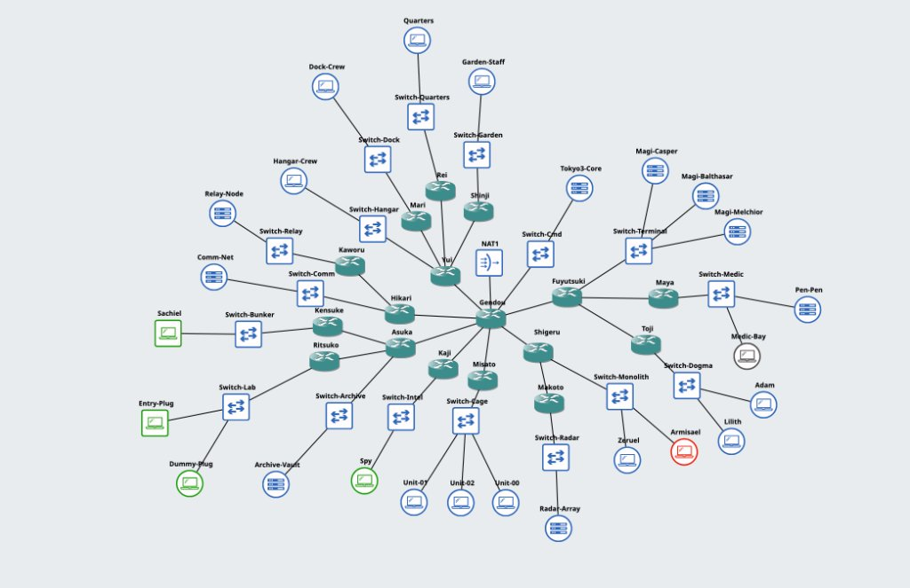

---

## Panduan Demo Cepat (Quick Start Script)

Setiap nomor soal telah dilengkapi script otomatisasi mandiri pada folder `src/soal-X/script.sh` serta script per-node pada `/root/<nama>.sh` di dalam setiap container GNS3. Script di folder `src/` mengenali nama node secara otomatis (`NODE="$(hostname)"`), sehingga saat demo praktikan cukup menjalankan 1 perintah:

```bash
# Menjalankan script konfigurasi & verifikasi per nomor soal (contoh Soal 5):
sh /root/src/soal-5/script.sh

# Menjalankan script konfigurasi mandiri di masing-masing node:
bash /root/$(hostname | tr 'A-Z' 'a-z').sh

# Atau menjalankan master setup runner:
sh /root/src/setup_all.sh
```

---

## Babak 1: Membangun Geofront (Soal 1 - 8)

### 1. Markas Tanpa Peta: Perhitungan VLSM & Pohon Pembagian IP

#### A. Deskripsi & Landasan Teori
Prefix kelompok **`10.65.0.0/16`** dibagi menggunakan metode **VLSM (Variable Length Subnet Masking)** untuk **17 LAN** dan **16 link antar-router** (total **33 subnet**), diurutkan dari kebutuhan host terbesar hingga terkecil dengan ketentuan:
1. Setiap subnet menggunakan **prefix terkecil yang muat** untuk menampung seluruh host ditambah 1 alamat IP gateway ($\text{Kebutuhan IP Usable} = \text{Jumlah Host} + 1$, dengan syarat $2^{32-P} - 2 \ge \text{Jumlah Host} + 1$).
2. **Aturan Tie-Break VLSM:** apabila ukuran blok subnet sama, **LAN dialokasikan lebih dulu daripada link antar-router**, lalu diurutkan sesuai **urutan Tabel Host** (No. 1 s/d 17). Untuk ke-16 link antar-router (masing-masing membutuhkan 2 IP usable yaitu `/30`), urutannya mengikuti urutan Tabel Host dari router anak (gateway LAN No. 1 s/d 16).
3. **Aturan Alamat Node:** Gateway selalu memakai IP usable pertama (`Network + 1`). Node pada switch diberi IP usable berikutnya (`Network + 2`, dst.) sesuai urutan penulisan pada Tabel Host / gambar dari kiri ke kanan. Pada link antar-router `/30`, router induk (arah `Gendo`) memakai IP usable pertama (`+1`) dan router anak memakai IP usable kedua (`+2`).

#### B. Tabel Pembagian VLSM (17 LAN & 16 Link Antar-Router)

File spreadsheet CSV juga tersedia pada repository: [`VLSM_K-03_Modul5.csv`](./VLSM_K-03_Modul5.csv) dan script cetak tabel pada [`src/soal-1/script.sh`](./src/soal-1/script.sh).

| No | Nama Subnet / Link | Router Gateway | Host | Network | Prefix | Netmask | Gateway | Broadcast | IP Terpakai | Sisa IP | Alokasi IP Node |
|---:|---|---|---:|---|---:|---|---|---|---:|---:|---|
| 1 | `Switch-Quarters` | Rei | 500 | `10.65.0.0` | `/23` | `255.255.254.0` | `10.65.0.1` | `10.65.1.255` | 501 | 9 | Quarters: `10.65.0.2` |
| 2 | `Switch-Comm` | Hikari | 200 | `10.65.2.0` | `/24` | `255.255.255.0` | `10.65.2.1` | `10.65.2.255` | 201 | 53 | Comm-Net: `10.65.2.2` |
| 3 | `Switch-Hangar` | Yui | 100 | `10.65.3.0` | `/25` | `255.255.255.128` | `10.65.3.1` | `10.65.3.127` | 101 | 25 | Hangar-Crew: `10.65.3.2` |
| 4 | `Switch-Bunker` | Kensuke | 55 | `10.65.3.128` | `/26` | `255.255.255.192` | `10.65.3.129` | `10.65.3.191` | 56 | 6 | Sachiel: `10.65.3.130` |
| 5 | `Switch-Medic` | Maya | 26 | `10.65.3.192` | `/27` | `255.255.255.224` | `10.65.3.193` | `10.65.3.223` | 27 | 3 | Pen-Pen: `10.65.3.194`, Medic-Bay: `10.65.3.195` |
| 6 | `Switch-Relay` | Kaworu | 25 | `10.65.3.224` | `/27` | `255.255.255.224` | `10.65.3.225` | `10.65.3.255` | 26 | 4 | Relay-Node: `10.65.3.226` |
| 7 | `Switch-Garden` | Shinji | 14 | `10.65.4.0` | `/27` | `255.255.255.224` | `10.65.4.1` | `10.65.4.31` | 15 | 15 | Garden-Staff: `10.65.4.2` |
| 8 | `Switch-Dock` | Mari | 12 | `10.65.4.32` | `/28` | `255.255.255.240` | `10.65.4.33` | `10.65.4.47` | 13 | 1 | Dock-Crew: `10.65.4.34` |
| **9** | **`Switch-Lab`** ⭕ | **Ritsuko** | **5** | **`10.65.4.48`** | **`/29`** | **`255.255.255.248`** | **`10.65.4.49`** | **`10.65.4.55`** | **6** | **0** | **Entry-Plug: `10.65.4.50`, Dummy-Plug: `10.65.4.51`** |
| 10 | `Switch-Terminal` | Fuyutsuki | 3 | `10.65.4.56` | `/29` | `255.255.255.248` | `10.65.4.57` | `10.65.4.63` | 4 | 2 | Magi-Casper: `10.65.4.58`, Magi-Balthasar: `10.65.4.59`, Magi-Melchior: `10.65.4.60` |
| 11 | `Switch-Cage` | Misato | 3 | `10.65.4.64` | `/29` | `255.255.255.248` | `10.65.4.65` | `10.65.4.71` | 4 | 2 | Unit-01: `10.65.4.66`, Unit-02: `10.65.4.67`, Unit-00: `10.65.4.68` |
| 12 | `Switch-Dogma` | Toji | 2 | `10.65.4.72` | `/29` | `255.255.255.248` | `10.65.4.73` | `10.65.4.79` | 3 | 3 | Lilith: `10.65.4.74`, Adam: `10.65.4.75` |
| **13** | **`Switch-Monolith`** ⭕ | **Shigeru** | **2** | **`10.65.4.80`** | **`/29`** | **`255.255.255.248`** | **`10.65.4.81`** | **`10.65.4.87`** | **3** | **3** | **Zeruel: `10.65.4.82`, Armisael: `10.65.4.83`** |
| 14 | `Switch-Radar` | Makoto | 4 | `10.65.4.88` | `/29` | `255.255.255.248` | `10.65.4.89` | `10.65.4.95` | 5 | 1 | Radar-Array: `10.65.4.90` |
| 15 | `Switch-Archive` | Asuka | 1 | `10.65.4.96` | `/30` | `255.255.255.252` | `10.65.4.97` | `10.65.4.99` | 2 | 0 | Archive-Vault: `10.65.4.98` |
| 16 | `Switch-Intel` | Kaji | 1 | `10.65.4.100` | `/30` | `255.255.255.252` | `10.65.4.101` | `10.65.4.103` | 2 | 0 | Spy: `10.65.4.102` |
| 17 | `Switch-Cmd` | Gendo | 1 | `10.65.4.104` | `/30` | `255.255.255.252` | `10.65.4.105` | `10.65.4.107` | 2 | 0 | Tokyo3-Core: `10.65.4.106` |
| 18 | `Link Yui-Rei` | Yui ↔ Rei | 2 | `10.65.4.108` | `/30` | `255.255.255.252` | `10.65.4.109` (Yui) | `10.65.4.111` | 2 | 0 | Yui: `10.65.4.109`, Rei: `10.65.4.110` |
| 19 | `Link Gendo-Hikari` | Gendo ↔ Hikari | 2 | `10.65.4.112` | `/30` | `255.255.255.252` | `10.65.4.113` (Gendo) | `10.65.4.115` | 2 | 0 | Gendo: `10.65.4.113`, Hikari: `10.65.4.114` |
| 20 | `Link Gendo-Yui` | Gendo ↔ Yui | 2 | `10.65.4.116` | `/30` | `255.255.255.252` | `10.65.4.117` (Gendo) | `10.65.4.119` | 2 | 0 | Gendo: `10.65.4.117`, Yui: `10.65.4.118` |
| 21 | `Link Asuka-Kensuke` | Asuka ↔ Kensuke | 2 | `10.65.4.120` | `/30` | `255.255.255.252` | `10.65.4.121` (Asuka) | `10.65.4.123` | 2 | 0 | Asuka: `10.65.4.121`, Kensuke: `10.65.4.122` |
| 22 | `Link Fuyutsuki-Maya` | Fuyutsuki ↔ Maya | 2 | `10.65.4.124` | `/30` | `255.255.255.252` | `10.65.4.125` (Fuyutsuki) | `10.65.4.127` | 2 | 0 | Fuyutsuki: `10.65.4.125`, Maya: `10.65.4.126` |
| 23 | `Link Hikari-Kaworu` | Hikari ↔ Kaworu | 2 | `10.65.4.128` | `/30` | `255.255.255.252` | `10.65.4.129` (Hikari) | `10.65.4.131` | 2 | 0 | Hikari: `10.65.4.129`, Kaworu: `10.65.4.130` |
| 24 | `Link Yui-Shinji` | Yui ↔ Shinji | 2 | `10.65.4.132` | `/30` | `255.255.255.252` | `10.65.4.133` (Yui) | `10.65.4.135` | 2 | 0 | Yui: `10.65.4.133`, Shinji: `10.65.4.134` |
| 25 | `Link Yui-Mari` | Yui ↔ Mari | 2 | `10.65.4.136` | `/30` | `255.255.255.252` | `10.65.4.137` (Yui) | `10.65.4.139` | 2 | 0 | Yui: `10.65.4.137`, Mari: `10.65.4.138` |
| **26** | **`Link Asuka-Ritsuko`** ⭕ | **Asuka ↔ Ritsuko** | **2** | **`10.65.4.140`** | **`/30`** | **`255.255.255.252`** | **`10.65.4.141` (Asuka)** | **`10.65.4.143`** | **2** | **0** | **Asuka: `10.65.4.141`, Ritsuko: `10.65.4.142`** |
| 27 | `Link Gendo-Fuyutsuki` | Gendo ↔ Fuyutsuki | 2 | `10.65.4.144` | `/30` | `255.255.255.252` | `10.65.4.145` (Gendo) | `10.65.4.147` | 2 | 0 | Gendo: `10.65.4.145`, Fuyutsuki: `10.65.4.146` |
| 28 | `Link Gendo-Misato` | Gendo ↔ Misato | 2 | `10.65.4.148` | `/30` | `255.255.255.252` | `10.65.4.149` (Gendo) | `10.65.4.151` | 2 | 0 | Gendo: `10.65.4.149`, Misato: `10.65.4.150` |
| 29 | `Link Fuyutsuki-Toji` | Fuyutsuki ↔ Toji | 2 | `10.65.4.152` | `/30` | `255.255.255.252` | `10.65.4.153` (Fuyutsuki) | `10.65.4.155` | 2 | 0 | Fuyutsuki: `10.65.4.153`, Toji: `10.65.4.154` |
| **30** | **`Link Gendo-Shigeru`** ⭕ | **Gendo ↔ Shigeru** | **2** | **`10.65.4.156`** | **`/30`** | **`255.255.255.252`** | **`10.65.4.157` (Gendo)** | **`10.65.4.159`** | **2** | **0** | **Gendo: `10.65.4.157`, Shigeru: `10.65.4.158`** |
| 31 | `Link Shigeru-Makoto` | Shigeru ↔ Makoto | 2 | `10.65.4.160` | `/30` | `255.255.255.252` | `10.65.4.161` (Shigeru) | `10.65.4.163` | 2 | 0 | Shigeru: `10.65.4.161`, Makoto: `10.65.4.162` |
| **32** | **`Link Gendo-Asuka`** ⭕ | **Gendo ↔ Asuka** | **2** | **`10.65.4.164`** | **`/30`** | **`255.255.255.252`** | **`10.65.4.165` (Gendo)** | **`10.65.4.167`** | **2** | **0** | **Gendo: `10.65.4.165`, Asuka: `10.65.4.166`** |
| 33 | `Link Gendo-Kaji` | Gendo ↔ Kaji | 2 | `10.65.4.168` | `/30` | `255.255.255.252` | `10.65.4.169` (Gendo) | `10.65.4.171` | 2 | 0 | Gendo: `10.65.4.169`, Kaji: `10.65.4.170` |

#### C. Gambar Pohon Pembagian IP (Jalur Dummy-Plug ke Armisael Dilingkari)

Jalur paket dari **Dummy-Plug** (`10.65.4.51`) menuju **Armisael** (`10.65.4.83`) melewati 5 subnet yang dilingkari merah tebal pada pohon IP di bawah ini:
1. **`Switch-Lab` (`10.65.4.48/29` - Subnet #9)**: `Dummy-Plug` (`10.65.4.51`) menuju gateway `Ritsuko` (`10.65.4.49`).
2. **`Link Asuka-Ritsuko` (`10.65.4.140/30` - Subnet #26)**: `Ritsuko` (`10.65.4.142`) meneruskan ke `Asuka` (`10.65.4.141`).
3. **`Link Gendo-Asuka` (`10.65.4.164/30` - Subnet #32)**: `Asuka` (`10.65.4.166`) meneruskan ke `Gendo` (`10.65.4.165`).
4. **`Link Gendo-Shigeru` (`10.65.4.156/30` - Subnet #30)**: `Gendo` (`10.65.4.157`) meneruskan ke `Shigeru` (`10.65.4.158`).
5. **`Switch-Monolith` (`10.65.4.80/29` - Subnet #13)**: `Shigeru` (`10.65.4.81`) mengirimkan paket ke `Armisael` (`10.65.4.83`).

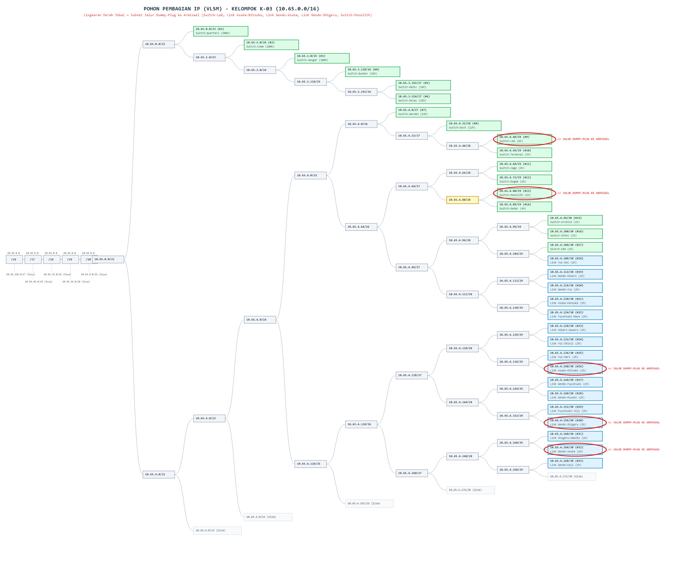

#### D. Penjelasan Perhitungan Satu Subnet (`Switch-Lab` - Subnet #9)
1. **Kebutuhan Alamat IP:**
   - Pada `Switch-Lab`, terdapat 2 container yang mewakili grup host: `Entry-Plug = 3` host dan `Dummy-Plug = 2` host, sehingga total host adalah $3 + 2 = 5$ host.
   - Ditambah 1 alamat IP untuk interface gateway (`Ritsuko`), total alamat IP usable yang dibutuhkan adalah $5 + 1 = 6$ alamat usable.
2. **Menentukan Prefix Terkecil yang Muat:**
   - Rumus kapasitas IP usable untuk $h$ bit host adalah $2^h - 2 \ge 6 \implies 2^h \ge 8 \implies h = 3$ bit host.
   - Panjang prefix adalah $32 - 3 = 29$ (`/29`, netmask `255.255.255.248`), dengan ukuran blok $2^3 = 8$ alamat total dan kapasitas usable $8 - 2 = 6$ alamat.
3. **Menentukan Network, Gateway, Alokasi Node, Broadcast, dan Sisa:**
   - Subnet sebelumnya (No. 8 `Switch-Dock`, `10.65.4.32/28`, ukuran blok 16) berakhir pada broadcast `10.65.4.47`.
   - **Network Address** `Switch-Lab` dimulai dari alamat berikutnya: **`10.65.4.48/29`**.
   - **Broadcast Address** adalah $10.65.4.48 + 8 - 1 =$ **`10.65.4.55`**.
   - Rentang IP usable adalah `10.65.4.49` s/d `10.65.4.54`:
     - **Gateway (`Ritsuko`):** `10.65.4.49` (usable ke-1)
     - **`Entry-Plug`:** `10.65.4.50` (usable ke-2)
     - **`Dummy-Plug`:** `10.65.4.51` (usable ke-3)
   - **IP Terpakai (hitungan VLSM):** $5\text{ host} + 1\text{ gateway} = 6$ IP.
   - **Sisa IP:** $6\text{ usable} - 6\text{ terpakai} = 0$ IP.

---

### 2. Geofront Gelap Gulita: Pemasangan Topologi, IP Router, & IP Forwarding

#### A. Deskripsi & Landasan Teori
Seluruh 17 router dipasang menggunakan image `ardhptr21/debinet:latest`. Agar setiap router dapat meneruskan paket antar-subnet, parameter kernel `net.ipv4.ip_forward=1` diaktifkan. Hanya router pusat **`Gendo`** yang terhubung ke `NAT1` pada interface `eth0` dan memperoleh alamat IP secara dinamis lewat DHCP (`192.168.122.17/24`).

#### B. Konfigurasi
Contoh script `/root/gendo.sh` (tahap Soal 2) dan script otomatisasi [`src/soal-2/script.sh`](./src/soal-2/script.sh):
```bash
#!/bin/bash
sysctl -w net.ipv4.ip_forward=1 >/dev/null
ip link set eth0 up
/gns3/bin/udhcpc -i eth0 -s /gns3/etc/udhcpc/default.script -q -n -t 3 >/dev/null 2>&1 || true

ip addr add 10.65.4.105/30 dev eth1 && ip link set eth1 up
ip addr add 10.65.4.113/30 dev eth2 && ip link set eth2 up
ip addr add 10.65.4.117/30 dev eth3 && ip link set eth3 up
ip addr add 10.65.4.145/30 dev eth4 && ip link set eth4 up
ip addr add 10.65.4.149/30 dev eth5 && ip link set eth5 up
ip addr add 10.65.4.157/30 dev eth6 && ip link set eth6 up
ip addr add 10.65.4.165/30 dev eth7 && ip link set eth7 up
ip addr add 10.65.4.169/30 dev eth8 && ip link set eth8 up
```

#### C. Hasil Pengujian & Verifikasi
1. **Pemeriksaan `ip -br a` dan `ip_forward` pada Router:**
   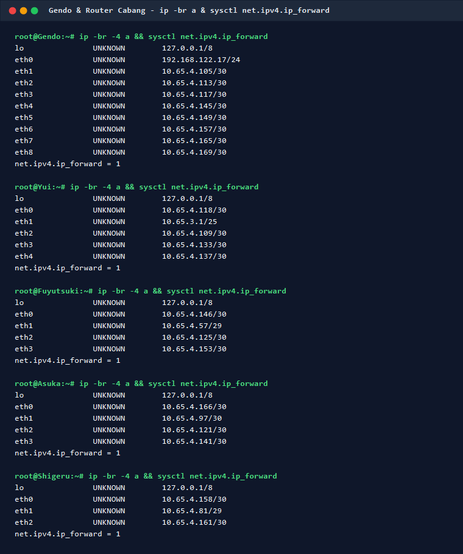

2. **Uji Ping Dua Ujung pada 16 Link Antar-Router:**
   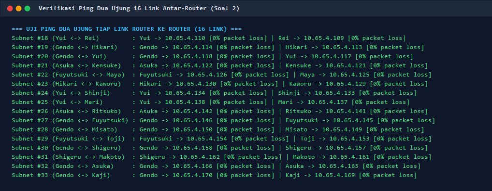
   *Penjelasan:* Ke-17 router telah memiliki alamat IP interface yang tepat sesuai tabel VLSM pada Soal 1, `net.ipv4.ip_forward = 1` aktif di seluruh router, dan pengujian ping dua arah pada seluruh 16 link point-to-point antar-router berhasil dengan 0% packet loss.

---

### 3. Pulau-Pulau yang Terpisah: Static Routing & Peringkasan CIDR

#### A. Deskripsi & Landasan Teori
Untuk menghubungkan seluruh segmen LAN dengan jumlah rute sesedikit mungkin:
1. **Router selain Gendo** cukup memakai **satu `default` route ke arah atas** (menuju router induknya) ditambah rute spesifik untuk subnet-subnet yang berada di bawah cabangnya.
2. **Gendo** memakai `default` route ke arah `NAT1` (`192.168.122.1`) dan rute statis menuju ke-7 cabang di bawahnya (`Hikari`, `Yui`, `Fuyutsuki`, `Misato`, `Shigeru`, `Asuka`, `Kaji`).
3. **Peringkasan CIDR (Route Summarization):** Pada cabang **`Shigeru`** (Zona Sensitif), terdapat dua subnet LAN bersebelahan dengan ukuran sama (`/29`) yang berada tepat pada batas blok `/28` (kelipatan 16, yaitu $80 = 5 \times 16$):
   - `Switch-Monolith`: `10.65.4.80/29` (`10.65.4.80` – `10.65.4.87`)
   - `Switch-Radar`: `10.65.4.88/29` (`10.65.4.88` – `10.65.4.95`)
   Kedua subnet tersebut digabung tepat menjadi satu blok CIDR **`10.65.4.80/28`** (`10.65.4.80` – `10.65.4.95`) pada tabel routing `Gendo`:
   ```bash
   ip route replace 10.65.4.80/28 via 10.65.4.158
   ```

#### B. Konfigurasi
Rute statis pada router cabang tingkat menengah (`Hikari`, `Yui`, `Fuyutsuki`, `Shigeru`, `Asuka`) dan router daun (`Rei`, `Kaworu`, `Shinji`, `Mari`, `Kensuke`, `Ritsuko`, `Maya`, `Toji`, `Misato`, `Makoto`, `Kaji`) dikonfigurasi melalui [`src/soal-3/script.sh`](./src/soal-3/script.sh):
```bash
# Pada Shigeru:
ip route replace default via 10.65.4.157
ip route replace 10.65.4.88/29 via 10.65.4.162

# Pada Fuyutsuki:
ip route replace default via 10.65.4.145
ip route replace 10.65.3.192/27 via 10.65.4.126
ip route replace 10.65.4.72/29 via 10.65.4.154

# Pada Asuka:
ip route replace default via 10.65.4.165
ip route replace 10.65.3.128/26 via 10.65.4.122
ip route replace 10.65.4.48/29 via 10.65.4.142
```

#### C. Hasil Pengujian & Verifikasi
1. **Tabel Routing Statis & Ringkasan CIDR `10.65.4.80/28` di Gendo:**
   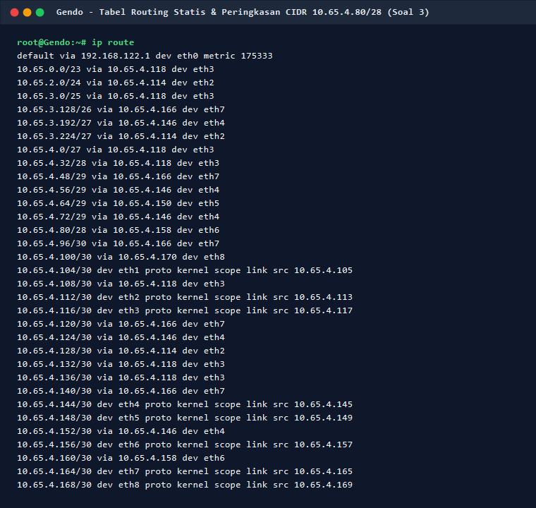

2. **Bukti Ping dari Armisael ke Lilith, Sachiel, dan Comm-Net:**
   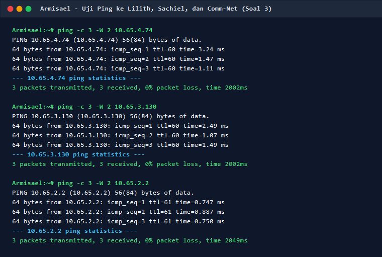
   *Penjelasan:* `Armisael` (`10.65.4.83` di bawah `Shigeru`) berhasil melakukan ping lintas cabang ke `Lilith` (`10.65.4.74` di bawah `Gendo -> Fuyutsuki -> Toji`), `Sachiel` (`10.65.3.130` di bawah `Gendo -> Asuka -> Kensuke`), dan `Comm-Net` (`10.65.2.2` di bawah `Gendo -> Hikari`) dengan 0% packet loss.

---

### 4. Haus Kabar dari Dunia Luar: Source NAT (MASQUERADE) & DNS

#### A. Deskripsi & Landasan Teori
Karena alamat IP `eth0` milik `Gendo` dari `NAT1` diberikan lewat DHCP dan dapat berubah sewaktu-waktu, digunakan target **`MASQUERADE`** pada tabel `nat` chain `POSTROUTING`. Agar hanya lalu lintas dari prefix internal (`10.65.0.0/16`) yang keluar menuju internet (`-o eth0`) yang diterjemahkan alamat sumbernya — sementara lalu lintas antar-LAN tetap membawa alamat IP asli pengirimnya — rule membatasi kriteria `-s 10.65.0.0/16 -o eth0`. Selain itu, setiap node diberi konfigurasi resolver `/etc/resolv.conf` (`nameserver 8.8.8.8`).

#### B. Konfigurasi
Rule NAT pada `Gendo` ([`src/soal-4/script.sh`](./src/soal-4/script.sh)):
```bash
iptables -t nat -F POSTROUTING
iptables -t nat -A POSTROUTING -s 10.65.0.0/16 -o eth0 -j MASQUERADE
```

#### C. Hasil Pengujian & Verifikasi
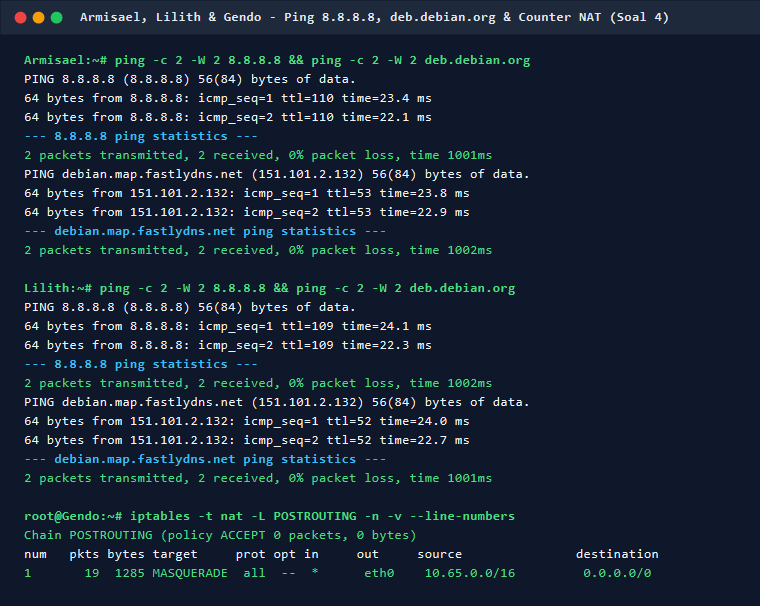
*Penjelasan:* `Armisael` dan `Lilith` berhasil melakukan `ping 8.8.8.8` serta me-resolve dan mem-ping domain `deb.debian.org`. Output `iptables -t nat -L POSTROUTING -n -v --line-numbers` di `Gendo` menunjukkan counter paket (`pkts = 19`, `bytes = 1285`) pada rule `MASQUERADE` bertambah.

---

### 5. Pintu Depan Dikunci Rapat: Default Deny & Stateful Firewall pada Gendo

#### A. Deskripsi & Landasan Teori
`Gendo` menerapkan strategi **Default Deny** dengan mengubah default policy chain `INPUT` dan `FORWARD` menjadi `DROP`, lalu mengizinkan secara eksplisit (whitelist) empat jenis lalu lintas ditambah loopback dan DHCP dari `NAT1`:
1. **(a) Balasan koneksi yang sudah ada (`ESTABLISHED,RELATED`)** menggunakan modul `conntrack` pada `INPUT` dan `FORWARD`.
2. **(b) Traffic dari jaringan internal ke internet**: `-s 10.65.0.0/16 ! -i eth0 -o eth0 -j ACCEPT` pada chain `FORWARD`.
3. **(c) Traffic antar-LAN**: `-s 10.65.0.0/16 -d 10.65.0.0/16 ! -i eth0 ! -o eth0 -j ACCEPT` pada chain `FORWARD`.
4. **(d) Traffic dari jaringan internal ke Gendo sendiri**: `-s 10.65.0.0/16 ! -i eth0 -j ACCEPT` pada chain `INPUT`.
5. **Loopback & DHCP dari NAT1**: `-i lo -j ACCEPT` dan `-i eth0 -p udp --sport 67 --dport 68 -j ACCEPT` pada chain `INPUT`.

Dengan susunan ini, paket koneksi baru (`NEW`) yang datang dari sisi `NAT1` (`-i eth0`) tidak cocok dengan rule mana pun dan otomatis dijatuhkan oleh default policy `DROP`.

#### B. Konfigurasi (`/root/gendo.sh`)
Script lengkap `/root/gendo.sh` dan [`src/soal-5/script.sh`](./src/soal-5/script.sh):
```bash
# Reset policy sementara sebelum flush agar tidak terkunci
iptables -P INPUT ACCEPT
iptables -P FORWARD ACCEPT
iptables -P OUTPUT ACCEPT
iptables -F INPUT
iptables -F FORWARD

# Chain INPUT:
iptables -A INPUT -i lo -j ACCEPT
iptables -A INPUT -m conntrack --ctstate ESTABLISHED,RELATED -j ACCEPT
iptables -A INPUT -i eth0 -p udp --sport 67 --dport 68 -j ACCEPT
iptables -A INPUT ! -i eth0 -s 10.65.0.0/16 -j ACCEPT

# Chain FORWARD:
iptables -A FORWARD -m conntrack --ctstate ESTABLISHED,RELATED -j ACCEPT
iptables -A FORWARD ! -i eth0 -o eth0 -s 10.65.0.0/16 -j ACCEPT
iptables -A FORWARD ! -i eth0 ! -o eth0 -s 10.65.0.0/16 -d 10.65.0.0/16 -j ACCEPT

# Ubah default policy INPUT dan FORWARD menjadi DROP:
iptables -P INPUT DROP
iptables -P FORWARD DROP
```

#### C. Hasil Pengujian & Verifikasi
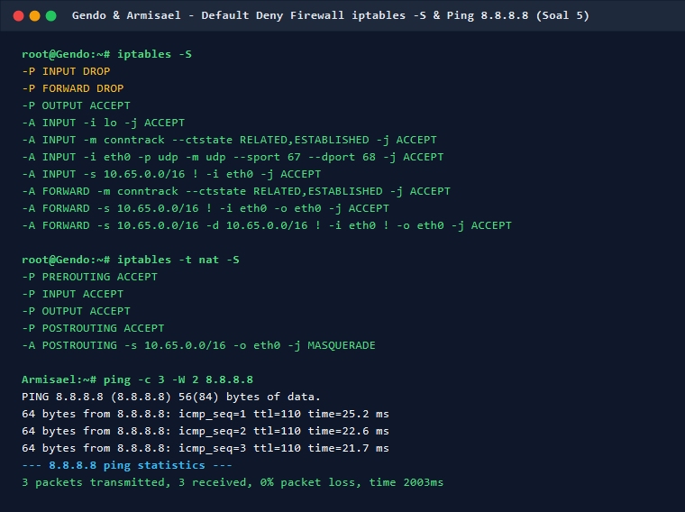
*Penjelasan:* `iptables -S` pada `Gendo` menampilkan policy `-P INPUT DROP` dan `-P FORWARD DROP` beserta ketujuh rule whitelist di atas, dan pengujian `ping 8.8.8.8` dari `Armisael` tetap berhasil dengan 0% packet loss.

---

### 6. Alamat Para Pilot: Konfigurasi IP Statis Permanen Seluruh Node Non-Router

#### A. Deskripsi & Landasan Teori
Seluruh 24 container non-router diberikan alamat IP statis, netmask, default gateway, dan DNS resolver sesuai aturan pengalamatan di Glosarium dan Tabel VLSM Soal 1. Agar konfigurasi bertahan setelah container di-restart, konfigurasi ditulis ke dalam `/etc/network/interfaces` (yang dibaca otomatis oleh init script container GNS3 saat booting) serta disimpan pada `/root/<nama>.sh`.

#### B. Konfigurasi
Contoh konfigurasi `/etc/network/interfaces` pada `Unit-01` ([`src/soal-6/script.sh`](./src/soal-6/script.sh)):
```conf
auto lo
iface lo inet loopback

auto eth0
iface eth0 inet static
    address 10.65.4.66
    netmask 255.255.255.248
    gateway 10.65.4.65
    up echo nameserver 8.8.8.8 > /etc/resolv.conf
```

#### C. Hasil Pengujian & Verifikasi
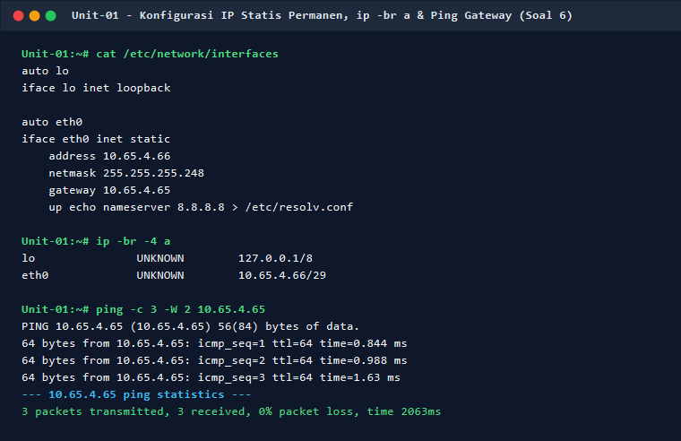
*Penjelasan:* Output `ip -br -4 a` pada `Unit-01` menampilkan alamat `10.65.4.66/29` pada `eth0`, dan pengujian `ping` ke gateway `Misato` (`10.65.4.65`) berhasil dengan 0% packet loss.

---

### 7. Membangunkan MAGI: Listener TCP pada Casper, Balthasar, dan Melchior

#### A. Deskripsi & Landasan Teori
Ketiga perangkat superkomputer MAGI di `Switch-Terminal` (`10.65.4.56/29`, gateway `Fuyutsuki` `10.65.4.57`) memasang paket `iptables` dan `netcat-traditional` melalui `/root/<nama>.sh`, lalu menyalakan listener TCP sesuai tabel layanan di Glosarium:
- **`Magi-Casper` (`10.65.4.58`)**: TCP port `5000`
- **`Magi-Balthasar` (`10.65.4.59`)**: TCP port `5000` dan `5001`
- **`Magi-Melchior` (`10.65.4.60`)**: TCP port `5000`

#### B. Konfigurasi
Contoh script `/root/magi-balthasar.sh` ([`src/soal-7/script.sh`](./src/soal-7/script.sh)):
```bash
#!/bin/bash
echo 'nameserver 8.8.8.8' > /etc/resolv.conf
ip addr flush dev eth0
ip addr add 10.65.4.59/29 dev eth0
ip link set eth0 up
ip route replace default via 10.65.4.57

if ! dpkg -s iptables netcat-traditional >/dev/null 2>&1; then
    export DEBIAN_FRONTEND=noninteractive
    apt-get update -y && apt-get install -y iptables netcat-traditional
fi
update-alternatives --set nc /bin/nc.traditional 2>/dev/null || true

pkill -f 'nc.traditional' 2>/dev/null || true
rm -f /root/log_5000.txt /root/log_5001.txt
touch /root/log_5000.txt /root/log_5001.txt
nohup sh -c 'while true; do nc.traditional -l -p 5000 >> /root/log_5000.txt 2>/dev/null; sleep 0.1; done' >/dev/null 2>&1 &
nohup sh -c 'while true; do nc.traditional -l -p 5001 >> /root/log_5001.txt 2>/dev/null; sleep 0.1; done' >/dev/null 2>&1 &
```

#### C. Hasil Pengujian & Verifikasi
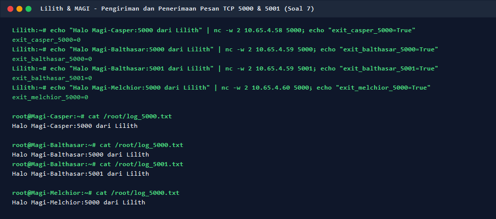
*Penjelasan:* Pengiriman pesan via `nc` dari `Lilith` (`10.65.4.74`) ke `Magi-Casper:5000`, `Magi-Balthasar:5000`, `Magi-Balthasar:5001`, dan `Magi-Melchior:5000` semuanya menghasilkan `exit=0`, dan masing-masing pesan tercatat di log penerima.

---

### 8. Mengenali Kondisi Normal: Layanan Pen-Pen & Tokyo3-Core

#### A. Deskripsi & Landasan Teori
Sebelum dipasang aturan firewall pada Babak 3, `Pen-Pen` (`10.65.3.194`) dan `Tokyo3-Core` (`10.65.4.106`) dijalankan dalam kondisi normal:
- Koneksi TCP ke **port `80`** pada `Pen-Pen` dijawab `Welcome to Pen-Pen`.
- Koneksi TCP ke **port `80`** pada `Tokyo3-Core` dijawab `Welcome to Tokyo3-Core`.
- Koneksi TCP ke **port `8080`** pada `Tokyo3-Core` dijawab `syifa imutz`.
- Koneksi ke port yang tidak dilayani (misalnya **port `22`**) tidak ditahan oleh `DROP`, melainkan langsung ditolak oleh stack TCP kernel dengan paket `TCP RST` (`Connection refused`) sehingga perintah `nc` selesai seketika (~0.003 detik) dengan `exit=1`, bukan menggantung sampai timeout.

#### B. Konfigurasi
Script `/root/tokyo3-core.sh` (tahap Soal 8) dan [`src/soal-8/script.sh`](./src/soal-8/script.sh):
```bash
#!/bin/bash
nohup sh -c 'while true; do printf "Welcome to Tokyo3-Core\n" | nc.traditional -l -p 80 -q 1 >/dev/null 2>&1; done' >/dev/null 2>&1 &
nohup sh -c 'while true; do printf "syifa imutz\n" | nc.traditional -l -p 8080 -q 1 >/dev/null 2>&1; done' >/dev/null 2>&1 &
```

#### C. Hasil Pengujian & Verifikasi
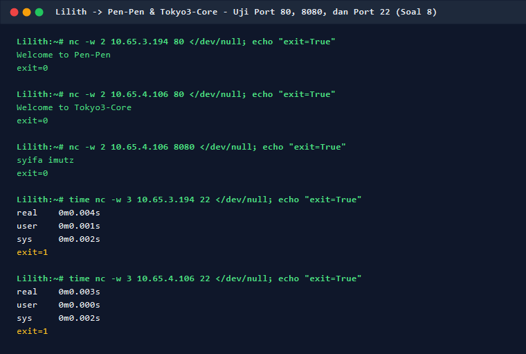
*Penjelasan:* Dari `Lilith`, koneksi `nc` ke `Pen-Pen:80` menerima `Welcome to Pen-Pen`, ke `Tokyo3-Core:80` menerima `Welcome to Tokyo3-Core`, dan ke `Tokyo3-Core:8080` menerima `syifa imutz` (`exit=0`). Sedangkan koneksi ke port `22` langsung gagal dalam waktu `0m0.003s` (`exit=1`), membuktikan port tertutup menolak koneksi seketika tanpa menggantung.

---

## Babak 2: Sabotase dan Hantu MAGI (Soal 9 - 12)

### 9. Jalur Belakang Diutak-Atik: Investigasi & Perbaikan Sabotase di Shigeru

#### A. Deskripsi & Analisis Penyebab Gejala
Setelah menjalankan `break_routing.sh` di `Shigeru` tanpa membaca isi filenya, ditemukan gejala: **`Lilith` tidak mendapat jawaban ping dari `Armisael`, padahal `Armisael` masih bisa mem-ping gateway-nya sendiri (`Shigeru` `10.65.4.81`)**.
Melalui pemeriksaan diagnostik (`sysctl net.ipv4.ip_forward`, `ip -br a`, `ip route`, dan `iptables -S`), ditemukan penyebabnya:
1. **IP Forwarding dimatikan (`net.ipv4.ip_forward = 0`)** dan/atau terdapat **rule `FORWARD DROP`** pada `Shigeru`: Ketika `Armisael` mem-ping gateway-nya sendiri (`10.65.4.81`), paket ditujukan langsung ke proses lokal `Shigeru` sehingga melewati jalur `PREROUTING -> INPUT` (tidak membutuhkan IP forwarding maupun chain `FORWARD`). Sebaliknya, paket dari `Lilith` menuju `Armisael` harus *melewati* `Shigeru` (`PREROUTING -> FORWARD -> POSTROUTING`), sehingga langsung terhenti ketika `ip_forward=0` atau dibuang di `FORWARD`.
2. **Default route pada `Shigeru` diubah/dihapus** (mengarah ke `Makoto` `10.65.4.162` atau hilang, bukan ke `Gendo` `10.65.4.157`): Akibatnya `Shigeru` tidak tahu jalan kembali untuk mengirim balasan paket menuju subnet di luar zona `Shigeru` (seperti `Lilith` di `10.65.4.72/29`).

#### B. Konfigurasi Perbaikan (`/root/shigeru.sh`)
Script perbaikan pada [`src/soal-9/script.sh`](./src/soal-9/script.sh):
```bash
#!/bin/bash
sysctl -w net.ipv4.ip_forward=1 >/dev/null
ip addr flush dev eth0 && ip addr add 10.65.4.158/30 dev eth0 && ip link set eth0 up
ip addr flush dev eth1 && ip addr add 10.65.4.81/29 dev eth1  && ip link set eth1 up
ip addr flush dev eth2 && ip addr add 10.65.4.161/30 dev eth2 && ip link set eth2 up

ip route replace default via 10.65.4.157
ip route replace 10.65.4.88/29 via 10.65.4.162

iptables -P INPUT ACCEPT
iptables -P FORWARD ACCEPT
iptables -P OUTPUT ACCEPT
iptables -F
iptables -t nat -F
```

#### C. Hasil Pengujian & Verifikasi
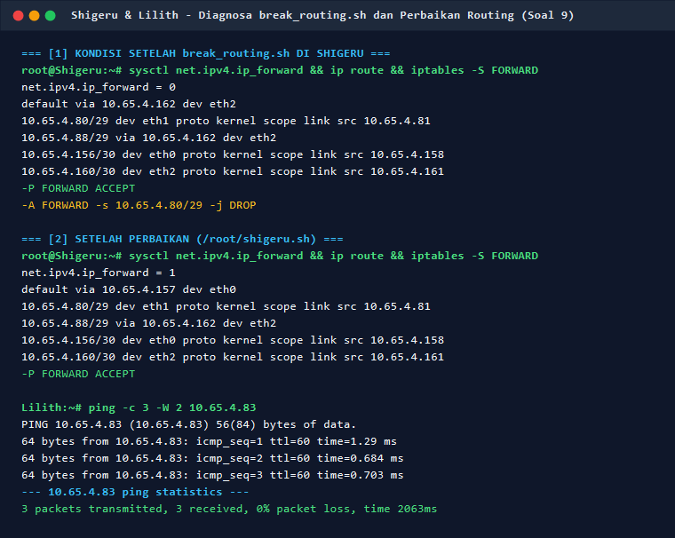
*Penjelasan:* Setelah `ip_forward=1`, tabel routing (`default via 10.65.4.157`), dan chain `FORWARD` pada `Shigeru` dipulihkan, `Lilith` kembali dapat mem-ping `Armisael` (`10.65.4.83`) dengan 0% packet loss.

---

### 10. Para Pilot Terkunci di Dalam: Investigasi & Perbaikan NAT pada Misato dan Gendo

#### A. Deskripsi & Analisis Penyebab Gejala
Setelah menjalankan `break_nat.sh` (file yang sama dijalankan di `Misato` dan di `Gendo`), muncul gejala:
- **`Unit-01`, `Unit-02`, dan `Unit-00` di `Switch-Cage` (`10.65.4.64/29`) tidak bisa ping `8.8.8.8`.**
- **`Spy` di `Switch-Intel` (`10.65.4.100/30`) tetap bisa ping `8.8.8.8` dengan normal.**
- **Ping dari `Cage` ke `Lilith` (`10.65.4.74`) tetap normal.**

**Penjelasan Mengapa Cage Terdampak tetapi Intel Tidak, dan Mengapa Cage ke Lilith Normal:**
1. **Mengapa Cage terdampak tetapi Intel tidak:**
   - Lalu lintas dari `Switch-Cage` (`10.65.4.64/29`) harus melewati router **`Misato`** terlebih dahulu sebelum menuju `Gendo`, sedangkan lalu lintas dari `Switch-Intel` (`10.65.4.100/30`) melewati router **`Kaji`** langsung ke `Gendo` tanpa pernah melewati `Misato`.
   - Selain itu, rule sabotase pada `break_nat.sh` menyasar subnet/jalur `Cage` (atau memasang rule `SNAT` yang salah pada `POSTROUTING` `eth0` di `Misato` menjadi IP di luar prefix internal `10.65.0.0/16` / memblokir subnet `10.65.4.64/29` menuju internet), sehingga ketika paket dari `Cage` tiba di `Gendo` untuk keluar ke `eth0` (`NAT1`), paket tersebut tidak cocok dengan rule `FORWARD` / `MASQUERADE -s 10.65.0.0/16 -o eth0` di `Gendo`. Karena `Spy` di `Intel` (`10.65.4.102`) datang dari `Kaji` dengan IP sumber asli `10.65.4.102` (masuk dalam `10.65.0.0/16`), paket `Spy` tetap di-MASQUERADE oleh `Gendo` dengan normal.
2. **Mengapa ping dari Cage ke Lilith tetap normal:**
   - Komunikasi dari `Cage` (`10.65.4.66`) ke `Lilith` (`10.65.4.74`) adalah lalu lintas **antar-LAN internal** (tujuan `-d 10.65.0.0/16`, keluar melalui `eth4` di `Gendo`, bukan keluar lewat `eth0`/`NAT1`), sehingga tidak membutuhkan translasi NAT ke internet dan tidak terkena rule yang hanya memengaruhi trafik keluar menuju internet (`! -d 10.65.0.0/16`).
3. **Di Router Mana Alamat Sumber Diterjemahkan:**
   - Alamat sumber **hanya diterjemahkan di router pusat `Gendo`** (pada chain `POSTROUTING` tabel `nat`, interface keluar `-o eth0` yang menghadap `NAT1`). Router internal seperti `Misato` tidak boleh melakukan NAT.

#### B. Konfigurasi Perbaikan
Membersihkan tabel `nat` dan `filter` pada `Misato` serta memulihkan rule `Gendo` ([`src/soal-10/script.sh`](./src/soal-10/script.sh)):
```bash
# Pada Misato:
iptables -t nat -F
iptables -F
bash /root/misato.sh

# Pada Gendo:
iptables -t nat -F
bash /root/gendo.sh
```

#### C. Hasil Pengujian & Verifikasi
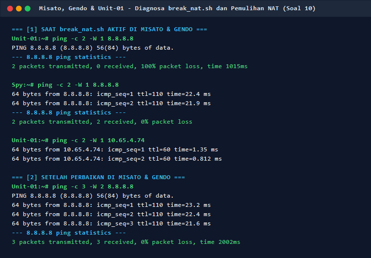
*Penjelasan:* Setelah tabel `nat` dan `filter` pada `Misato` dan `Gendo` dibersihkan dan dikembalikan ke konfigurasi `/root/misato.sh` serta `/root/gendo.sh`, `Unit-01` kembali berhasil mem-ping `8.8.8.8` dengan 0% packet loss.

---

### 11. Casper Harus Jadi Hantu: Memblokir Ping Masuk Tanpa Mematikan Ping Keluar

#### A. Deskripsi & Landasan Teori
Agar tidak ada perangkat lain yang bisa mem-ping `Magi-Casper` (`10.65.4.58`) — termasuk `Magi-Balthasar` dan `Magi-Melchior` yang berada di satu switch (`Switch-Terminal`) — rule firewall harus dipasang langsung sebagai **Host-Based Firewall pada chain `INPUT` di `Magi-Casper`**.
- Untuk memblokir ping yang datang dari luar ke `Casper`, kita membuang paket **`ICMP echo-request` (Type 8)**:
  `iptables -A INPUT -p icmp --icmp-type echo-request -j DROP`
- Sementara ketika `Casper` sendiri yang mem-ping perangkat lain, paket balasan yang masuk ke `Casper` bertipe **`ICMP echo-reply` (Type 0)** (dan berstatus `ESTABLISHED`), sehingga tidak terblokir oleh rule `echo-request` dan `Casper` tetap bebas mem-ping siapa saja. Layanan TCP port `5000` juga tidak terpengaruh.

#### B. Konfigurasi
Rule pada `Magi-Casper` ([`src/soal-11/script.sh`](./src/soal-11/script.sh)):
```bash
iptables -A INPUT -p icmp --icmp-type echo-request -j DROP
```

#### C. Hasil Pengujian & Verifikasi
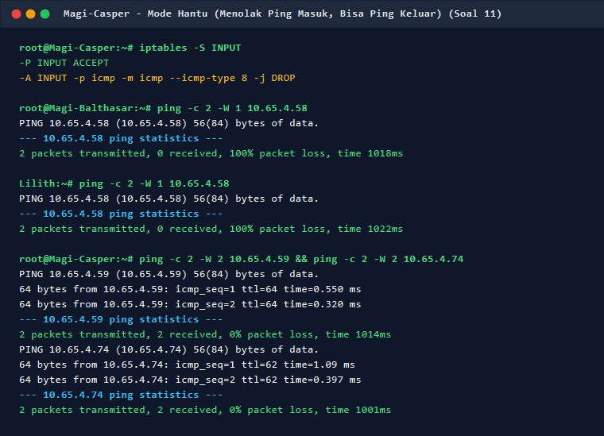
*Penjelasan:* Ping menuju `Magi-Casper` (`10.65.4.58`) dari `Magi-Balthasar` (tetangga satu switch) maupun dari `Lilith` (beda subnet) mengalami **100% packet loss (gagal)**. Sebaliknya, ping dari `Magi-Casper` menuju `Magi-Balthasar` (`10.65.4.59`) dan `Lilith` (`10.65.4.74`) **berhasil (0% packet loss)**.

---

### 12. Teknisi yang Kelewat Semangat: Perbaikan Hardening Firewall di Magi-Casper

#### A. Deskripsi & Analisis Penyebab Gejala
Setelah menjalankan `break_fw.sh` pada `Magi-Casper`, teknisi mengubah policy `INPUT` menjadi `DROP` untuk tujuan hardening, namun melakukan beberapa kesalahan yang menyebabkan:
1. **`Casper` tidak bisa `ping 8.8.8.8` dan tidak bisa `apt-get update`:**
   - Karena policy `INPUT` adalah `DROP`, tetapi teknisi **lupa memasang rule stateful (`-m conntrack --ctstate ESTABLISHED,RELATED -j ACCEPT`)** (serta loopback `-i lo -j ACCEPT`). Akibatnya, meskipun permintaan ping (`echo-request`), query DNS (UDP 53), dan koneksi HTTP repo Debian (TCP 80) berhasil keluar lewat `OUTPUT`, seluruh **paket balasannya** ditolak oleh policy `INPUT DROP`.
2. **`Unit-00` tidak bisa menyambung ke TCP `5000` `Casper`:**
   - Rule pembuka port layanan TCP `5000` pada chain `INPUT` salah tulis nomor port (misalnya `--dport 500`) atau belum diizinkan sebelum terkena policy `INPUT DROP`.
3. **Ping ke `Casper` tetap ditolak:**
   - Rule `-A INPUT -p icmp --icmp-type echo-request -j DROP` diletakkan **sebelum** rule `ESTABLISHED,RELATED` agar permintaan ping baru ke `Casper` tetap ditolak sementara balasan `echo-reply` untuk ping yang dikirim `Casper` lolos lewat `ESTABLISHED,RELATED`.

#### B. Konfigurasi Perbaikan (`/root/magi-casper.sh`)
Script perbaikan pada [`src/soal-12/script.sh`](./src/soal-12/script.sh) yang mempertahankan `policy INPUT DROP`:
```bash
iptables -P INPUT ACCEPT
iptables -F

# 1. Izinkan loopback
iptables -A INPUT -i lo -j ACCEPT
# 2. Tolak semua ping masuk (echo-request) ke Casper (Soal 11)
iptables -A INPUT -p icmp --icmp-type echo-request -j DROP
# 3. Izinkan semua paket balasan (echo-reply, DNS, HTTP apt-get update)
iptables -A INPUT -m conntrack --ctstate ESTABLISHED,RELATED -j ACCEPT
# 4. Izinkan koneksi masuk ke layanan TCP port 5000 Casper
iptables -A INPUT -p tcp --dport 5000 -j ACCEPT

# Pertahankan tujuan hardening: default policy INPUT dan FORWARD tetap DROP
iptables -P INPUT DROP
iptables -P FORWARD DROP
iptables -P OUTPUT ACCEPT
```

#### C. Hasil Pengujian & Verifikasi
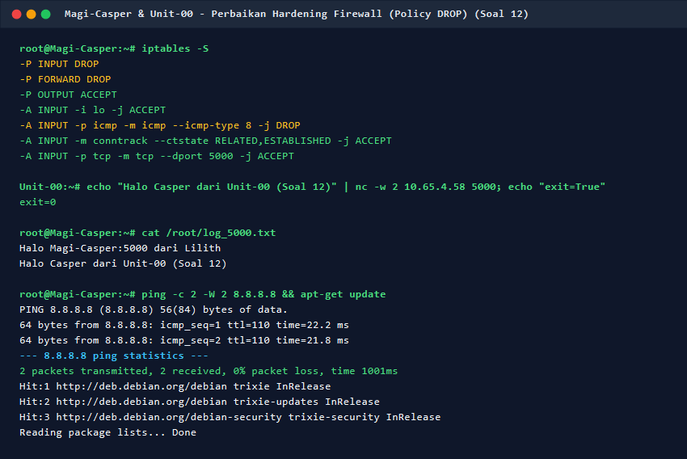
*Penjelasan:* Dengan policy `INPUT` tetap `DROP`, koneksi `nc` dari `Unit-00` ke `Magi-Casper` port `5000` berhasil (`exit=0` dan pesan tercatat di `/root/log_5000.txt`), serta `ping 8.8.8.8` dan `apt-get update` di `Magi-Casper` berjalan lancar hingga `Done`.

---

## Babak 3: Mengamankan MAGI dan Zona Sensitif (Soal 13 - 15)

### 13. Brankas Balthasar: Pembatasan Akses TCP 5000 & 5001 dengan REJECT Seketika

#### A. Deskripsi & Landasan Teori
Karena `Magi-Balthasar` (`10.65.4.59`) juga harus dilindungi dari tetangga satu switch (`Magi-Melchior` `10.65.4.60`), aturan dipasang langsung pada chain **`INPUT` di `Magi-Balthasar`**:
1. Hanya **`Magi-Casper` (`10.65.4.58`)** dan keempat anggota kategori **Pilot** (**`Unit-01` `10.65.4.66`**, **`Unit-02` `10.65.4.67`**, **`Unit-00` `10.65.4.68`**, dan **`Sachiel` `10.65.3.130`**) yang diizinkan (`ACCEPT`) mengakses TCP port `5000` dan `5001`.
2. Seluruh node lain yang mencoba mengakses TCP port `5000` atau `5001` harus **langsung ditolak seketika** (bukan menggantung sampai timeout), sehingga wajib menggunakan target **`REJECT --reject-with tcp-reset`** (atau `REJECT`).
3. Lalu lintas lain (seperti ICMP ping ke `8.8.8.8` dan balasannya) tidak terganggu karena policy `INPUT` tetap `ACCEPT` dan rule `REJECT` hanya mencocokkan `-p tcp -m multiport --dports 5000,5001`.

#### B. Konfigurasi (`/root/magi-balthasar.sh`)
Script pada [`src/soal-13/script.sh`](./src/soal-13/script.sh):
```bash
iptables -P INPUT ACCEPT
iptables -F

# Whitelist: Casper (10.65.4.58) dan semua Pilot (Unit-01, Unit-02, Unit-00, Sachiel)
for src_ip in 10.65.4.58 10.65.4.66 10.65.4.67 10.65.4.68 10.65.3.130; do
    iptables -A INPUT -p tcp -s "$src_ip" -m multiport --dports 5000,5001 -j ACCEPT
done

# Tolak seketika node lain di kedua port tersebut
iptables -A INPUT -p tcp -m multiport --dports 5000,5001 -j REJECT --reject-with tcp-reset
```

#### C. Hasil Pengujian & Verifikasi
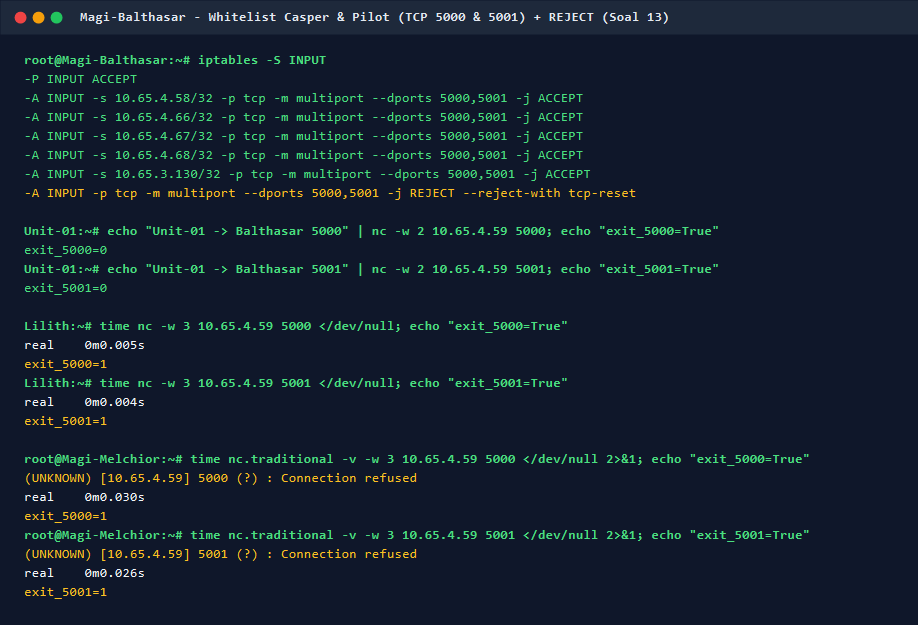
*Penjelasan:*
- **`Unit-01` (Pilot)** berhasil mengirim pesan ke port `5000` dan `5001` `Magi-Balthasar` (`exit_5000=0`, `exit_5001=0`).
- **`Lilith` (Staf)** dan **`Magi-Melchior` (tetangga satu switch)** langsung ditolak seketika (`Connection refused`, durasi hanya `0.004s` – `0.030s` dari batas timeout `-w 3`, dengan `exit=1`).

---

### 14. Jam Kunjungan Sang Pinguin: Firewall Berbasis Waktu (UTC) pada Pen-Pen

#### A. Deskripsi & Landasan Teori
`Pen-Pen` (`10.65.3.194`) membatasi akses **ping (`ICMP echo-request`)** dan **TCP port `80`** berdasarkan kategori pengirim dan jadwal waktu menggunakan modul `-m time`.
Karena modul `time` pada `iptables` membaca jam kernel dalam **UTC** ($\text{UTC} = \text{WIB} - 7\text{ jam}$):
- **Pilot (`Unit-01`, `Unit-02`, `Unit-00`, `Sachiel`)**: `08.00` s/d `16.00` WIB (Senin–Jumat) $\implies$ **`01:00` s/d `09:00` UTC**, `--weekdays Mon,Tue,Wed,Thu,Fri`.
- **Staf Geofront (`Lilith`, `Adam`)**: `17.00` s/d `23.00` WIB (Setiap hari) $\implies$ **`10:00` s/d `16:00` UTC**.
- **Terduga Dummy System (`Dummy-Plug` `10.65.4.51`, `Entry-Plug` `10.65.4.50`, `Spy` `10.65.4.102`)**: Tidak pernah (**Selalu ditolak / `DROP`**).
- **Lainnya**: Bebas tanpa batasan (`ACCEPT`).

Sesuai instruksi soal, kelima parameter jadwal disimpan sebagai variabel di awal script `/root/pen-pen.sh`: `PILOT_START`, `PILOT_STOP`, `PILOT_DAYS`, `STAF_START`, dan `STAF_STOP`.

#### B. Konfigurasi (`/root/pen-pen.sh`)
Script pada [`src/soal-14/script.sh`](./src/soal-14/script.sh):
```bash
#!/bin/bash
PILOT_START="01:00"
PILOT_STOP="09:00"
PILOT_DAYS="Mon,Tue,Wed,Thu,Fri"
STAF_START="10:00"
STAF_STOP="16:00"

iptables -P INPUT ACCEPT
iptables -F
iptables -X PENPEN_SCHED 2>/dev/null || true
iptables -N PENPEN_SCHED

# 1. Terduga Dummy System (Dummy-Plug, Entry-Plug, Spy) -> Selalu ditolak
for ip in 10.65.4.51 10.65.4.50 10.65.4.102; do
    iptables -A PENPEN_SCHED -s "$ip" -j DROP
done

# 2. Pilot (Unit-01, Unit-02, Unit-00, Sachiel) -> Sesuai jadwal Pilot
for ip in 10.65.4.66 10.65.4.67 10.65.4.68 10.65.3.130; do
    iptables -A PENPEN_SCHED -s "$ip" -m time --timestart "$PILOT_START" --timestop "$PILOT_STOP" --weekdays "$PILOT_DAYS" -j ACCEPT
    iptables -A PENPEN_SCHED -s "$ip" -j DROP
done

# 3. Staf Geofront (Lilith, Adam) -> Sesuai jadwal Staf
for ip in 10.65.4.74 10.65.4.75; do
    iptables -A PENPEN_SCHED -s "$ip" -m time --timestart "$STAF_START" --timestop "$STAF_STOP" -j ACCEPT
    iptables -A PENPEN_SCHED -s "$ip" -j DROP
done

# 4. Lainnya -> Bebas tanpa batasan
iptables -A PENPEN_SCHED -j ACCEPT

# Berlaku untuk ping (echo-request) dan TCP 80 ke Pen-Pen
iptables -A INPUT -p icmp --icmp-type echo-request -j PENPEN_SCHED
iptables -A INPUT -p tcp --dport 80 -j PENPEN_SCHED
```

#### C. Hasil Pengujian & Verifikasi (Kondisi Jadwal Cocok vs Tidak Cocok)
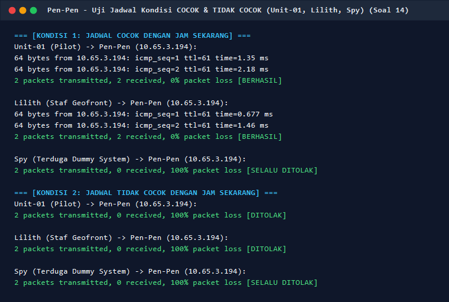
*Penjelasan:*
1. **Saat variabel diubah agar cocok dengan jam UTC sekarang (`sh /root/src/soal-14/script.sh cocok`):**
   - `Unit-01` (Pilot) $\to$ **Berhasil (0% packet loss)**
   - `Lilith` (Staf Geofront) $\to$ **Berhasil (0% packet loss)**
   - `Spy` (Terduga Dummy System) $\to$ **Gagal (100% packet loss - selalu ditolak)**
2. **Saat variabel diubah agar tidak cocok dengan jam UTC sekarang (`sh /root/src/soal-14/script.sh tidak_cocok`):**
   - `Unit-01` (Pilot) $\to$ **Gagal (100% packet loss)**
   - `Lilith` (Staf Geofront) $\to$ **Gagal (100% packet loss)**
   - `Spy` (Terduga Dummy System) $\to$ **Gagal (100% packet loss)**

---

### 15. Banjir Ping di Pusat Komando: Pembatasan Laju Ping (Rate Limiting) di Tokyo3-Core

#### A. Deskripsi & Landasan Teori
Untuk melindungi `Tokyo3-Core` (`10.65.4.106`) dari banjir ping (*ping flood*) agar hanya menjawab maksimal **5 ping per detik** dan membuang kelebihannya:
1. Rule dipasang pada chain **`INPUT`** dengan mencocokkan spesifik paket **`-p icmp --icmp-type echo-request`** (ICMP Type 8).
2. Mengapa harus spesifik `--icmp-type echo-request`? Karena jika hanya menulis `-p icmp`, maka paket **`echo-reply` (Type 0)** yang masuk ketika `Tokyo3-Core` sendiri melakukan ping keluar juga akan ikut terbatasi. Dengan membatasi hanya `echo-request` pada `INPUT`, ping yang dikirim `Tokyo3-Core` sendiri sama sekali tidak terbatasi.
3. Digunakan dua rule berurutan:
   - Rule 1: `-m limit --limit 5/second --limit-burst 5 -j ACCEPT` (meloloskan hingga 5 ping per detik dengan burst awal 5 paket).
   - Rule 2: `-p icmp --icmp-type echo-request -j DROP` (membuang seluruh paket `echo-request` yang melebihi kuota limit di Rule 1).

#### B. Konfigurasi (`/root/tokyo3-core.sh`)
Script pada [`src/soal-15/script.sh`](./src/soal-15/script.sh):
```bash
iptables -P INPUT ACCEPT
iptables -F

iptables -A INPUT -p icmp --icmp-type echo-request -m limit --limit 5/second --limit-burst 5 -j ACCEPT
iptables -A INPUT -p icmp --icmp-type echo-request -j DROP
```

#### C. Hasil Pengujian & Verifikasi
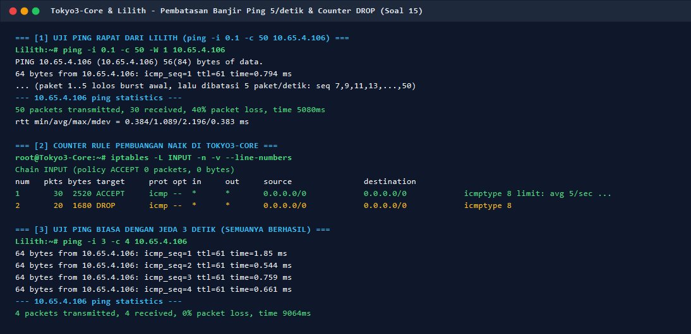
*Penjelasan:*
1. **Uji Ping Rapat (`ping -i 0.1 -c 50 10.65.4.106` dari `Lilith`, 10 paket/detik selama 5 detik):**
   - Dari 50 paket yang dikirim dalam ~5 detik, hanya **30 paket yang diterima** (5 paket burst awal + $5\text{ detik} \times 5\text{ paket/detik} = 30$ paket) dan **20 paket hilang (40% packet loss)**.
   - Output `iptables -L INPUT -n -v --line-numbers` pada `Tokyo3-Core` membuktikan Rule 1 (`ACCEPT`) menangani `30 pkts` dan counter Rule 2 (`DROP`) naik menjadi **`20 pkts` (`1680 bytes`)**.
2. **Uji Ping Biasa dengan Jeda Minimal 3 Detik (`ping -i 3 -c 4 10.65.4.106`):**
   - Seluruh 4 paket berhasil dijawab (**0% packet loss**) karena laju 1 paket per 3 detik berada jauh di bawah batas 5 paket per detik.
